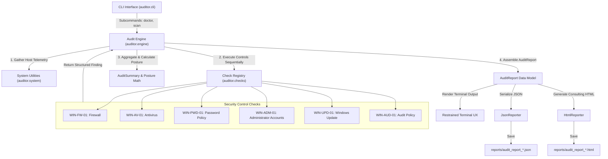

# System Architecture

The **Automated IT Security Controls Auditor** is architected as a lightweight, modular, zero-dependency Python assessment suite. It is designed around the principles of read-only telemetry gathering, deterministic finding evaluation, graceful error boundary containment, and dual-format reporting.

---

## 1. High-Level Architecture & Flow



---

## 2. Main Modules & Responsibilities

| Module | File Location | Core Responsibility |
| :--- | :--- | :--- |
| **CLI & UX** | `auditor/cli.py` | Command-line argument parsing (`doctor`, `scan`), terminal width detection, indented text wrapping, ANSI color formatting, and process exit code management. |
| **Data Models** | `auditor/models.py` | Strongly typed dataclasses and enumerations: `CheckStatus`, `RiskLevel`, `Finding`, `SystemInfo`, `AuditSummary`, and `AuditReport`. |
| **Engine** | `auditor/engine.py` | Orchestrates check sequencing, execution timing, finding collation, compliance score calculations, and simulated demo report generation. |
| **System Abstraction** | `auditor/system.py` | Safe subprocess execution with strict timeouts, execution policy bypass for PowerShell, privilege detection (`IsUserAnAdmin`), and host metadata collection. |
| **Configuration** | `auditor/config.py` | Documented baseline thresholds (e.g. minimum password length, maximum patch age, approved admin accounts). |
| **Check Registry** | `auditor/checks/__init__.py` | Discovery and factory instantiation of all registered control checks. |
| **Base Check** | `auditor/checks/base.py` | Abstract `BaseCheck` base class providing the standard execution lifecycle, platform compatibility verification, and defensive exception isolation. |
| **Security Checks** | `auditor/checks/*.py` | Individual control evaluation implementations querying Windows subsystem APIs and commands (`netsh`, `net`, `Get-MpComputerStatus`, `Get-HotFix`, `auditpol`). |
| **HTML Reporter** | `auditor/reporting/html_reporter.py` | Produces standalone, consulting-grade HTML deliverables with light-theme typography, executive summaries, finding tables, and print stylesheets. |
| **JSON Reporter** | `auditor/reporting/json_reporter.py` | Serializes complete audit models into structured JSON for automated ingestion, diffing, or SIEM pipelines. |

---

## 3. Security Check Interface & Execution Lifecycle

Every security check inherits from `BaseCheck` ([`auditor/checks/base.py`](file:///c:/Jothish/Automated-IT-Security-Controls-Auditor/auditor/checks/base.py)):

```python
class BaseCheck(ABC):
    check_id: str
    control_name: str
    description: str
    requires_windows: bool = True
    requires_elevation: bool = False

    @abstractmethod
    def execute(self, config: AuditConfig) -> Finding:
        """Subclass implementation collecting evidence and evaluating baseline."""
        raise NotImplementedError
```

### Execution Lifecycle:
1. **Platform Validation**: `run()` checks if `requires_windows` is True and the host OS is not Windows. If not Windows, it immediately returns a `NOT_APPLICABLE` finding without attempting invalid command calls.
2. **Defensive Error Handling**: The call to `execute()` is wrapped in a universal `try...except Exception` boundary. If an unhandled exception occurs (e.g. unexpected command output or system error), it is caught and converted to an `ERROR` finding with full error details. An individual check failure will never crash the suite.
3. **Structured Result**: Returns a standard `Finding` object containing observed evidence, expected requirement, risk level, short finding, explanation, impact, remediation, and verification limitations.

---

## 4. Findings & Audit Data Representation

Findings are defined as structured dataclasses:

```python
@dataclass
class Finding:
    check_id: str                      # e.g., "WIN-PWD-01"
    control_name: str                  # e.g., "Password and Account Lockout Policy"
    status: CheckStatus                # PASS | FAIL | REVIEW | ERROR | NOT_APPLICABLE
    risk_level: RiskLevel              # CRITICAL | HIGH | MEDIUM | LOW | INFORMATIONAL
    short_finding: str                 # 1-sentence concise description for CLI & summary
    explanation: str                   # Full detailed technical analysis
    observed_evidence: Any             # Parsed dictionary or list of raw evidence
    expected_requirement: str          # Defined baseline standard
    impact: str                        # Security/business risk of noncompliance
    recommended_remediation: str       # Actionable corrective guidance
    suggested_verification: str        # Specific command or GUI step to confirm fix
    verification_limitations: str      # Inspection scope boundary (e.g. SAM vs GPO)
```

### Authoritative Status Definitions:
- **`PASS`**: Concrete evidence confirms the configured baseline is met.
- **`FAIL`**: Evidence confirms the baseline is violated.
- **`REVIEW`**: Evidence requires human risk assessment (e.g., verifying business authorization for local administrators or third-party EDR).
- **`ERROR`**: The check could not execute or lacked required elevation (e.g., `auditpol` requiring administrative token).
- **`NOT_APPLICABLE`**: The check does not apply to the host environment.

> **Integrity Rule**: `ERROR`, `REVIEW`, and `NOT_APPLICABLE` are never counted as `PASS`. Missing or unverified data is never falsified.

---

## 5. Result Summarization & Posture Calculations

The `AuditEngine` calculates summary counts directly from the collected findings:
- `total_checks`: Total number of executed controls.
- `pass_count`, `fail_count`, `review_count`, `error_count`, `not_applicable_count`.
- `compliance_score_percent`: Calculated strictly as:
  $$\text{Pass Rate} = \left(\frac{\text{pass\_count}}{\text{total\_checks} - \text{not\_applicable\_count}}\right) \times 100$$
- `risk_breakdown`: Counts of findings mapped to `CRITICAL`, `HIGH`, `MEDIUM`, `LOW`, and `INFORMATIONAL`.

---

## 6. Report Generation Pipeline

1. **JSON Generation**:
   - `JsonReporter.generate(report, output_path)` converts `report.to_dict()` into formatted, UTF-8 JSON.
   - Includes metadata, system telemetry, audit duration, summary metrics, findings, and scope disclaimers.
2. **HTML Generation**:
   - `HtmlReporter.generate(report, output_path)` compiles an executive consulting document.
   - Uses embedded, responsive CSS with zero external network requests (opens offline anywhere).
   - Injects sanitized, HTML-escaped data for security.
   - Features anchor links linking summary rows to detailed finding cards.
   - Includes a prioritized remediation action plan ordered by risk severity ($P1 \to P5$).
   - Formatted with `@media print` rules for saving directly as PDF.

---

## 7. Exit Code Architecture

The CLI enforces a deterministic, automated-pipeline-friendly exit code policy:
- **`0`**: The audit executed successfully and zero controls were classified as `FAIL`.
- **`1`**: The audit executed successfully, but one or more controls were classified as `FAIL` (action required).
- **`2`**: A fatal error occurred (syntax error, bad arguments, unhandled fatal CLI crash).
